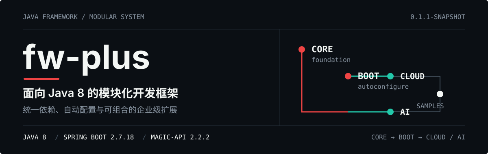
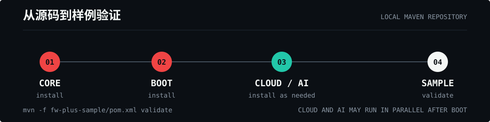
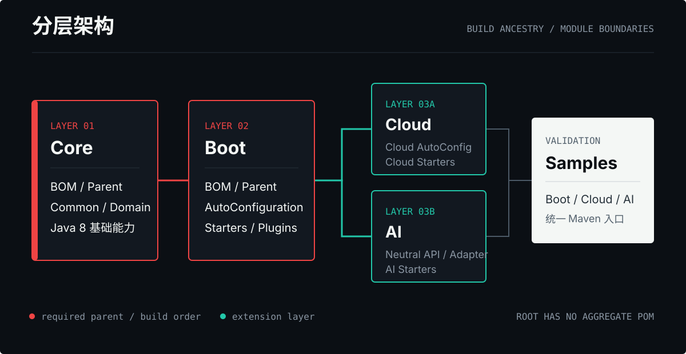
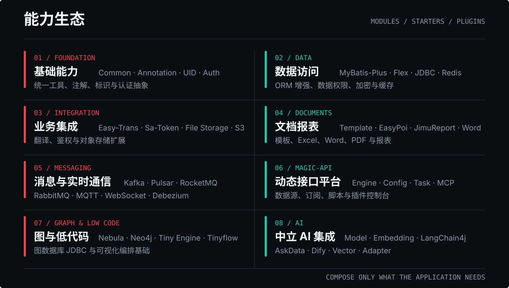

<p align="center">
  
</p>

<p align="center">
  <strong>统一依赖、自动配置与可组合扩展，为 Spring Boot 2.7.x 项目提供完整的工程能力底座。</strong>
</p>

<p align="center">
  <a href="#项目概览">项目概览</a> ·
  <a href="#快速开始">快速开始</a> ·
  <a href="#分层架构">分层架构</a> ·
  <a href="#能力与模块">能力与模块</a> ·
  <a href="#magic-api-资源模型">Magic-API</a> ·
  <a href="#样例项目">样例项目</a> ·
  <a href="#开发与维护">开发与维护</a> ·
  <a href="#兼容性与限制">兼容性</a>
</p>

## 项目概览

**fw-plus** 是一个面向 Java 8 与 Spring Boot 2.7.18 的模块化 Java 开发框架。它将公共基础能力、ORM 增强、Spring Boot 自动配置、Spring Cloud 扩展、Magic-API 插件、AI 适配层、图数据库 JDBC、文档报表和样例项目组织为四个可独立构建的库层。

项目强调按需组合，而不是要求应用一次性引入所有能力：

- **统一版本**：每层提供 BOM 与 Parent，四个库层使用同一 `0.1.1-SNAPSHOT` 版本线。
- **自动配置**：Boot、Cloud 与 AI 层通过 AutoConfiguration 和 Starter 收敛集成成本。
- **插件化扩展**：Magic-API 将数据源、消息、任务、认证、文档、MCP 与低代码能力拆分为独立插件。
- **中立 AI 边界**：模型与向量存储使用中立接口，LangChain4j 作为显式 Adapter 接入。
- **真实样例验证**：Boot、Cloud、AI 样例集中在 `fw-plus-sample/`，通过统一 Maven 聚合入口校验。

| 层级 | Maven GroupId | 主要职责 |
| --- | --- | --- |
| [Core](./fw-plus-core/) | `com.xiongx9527.fw.plus` | 公共能力、ORM、认证、模板报表、图数据库、AI 基础与 BOM |
| [Boot](./fw-plus-boot/) | `com.xiongx9527.fw.plus.boot` | Spring Boot 自动配置、Starter 与 Magic-API 插件 |
| [Cloud](./fw-plus-cloud/) | `com.xiongx9527.fw.plus.cloud` | Spring Cloud 自动配置、注册中心、网关与 Cloud 插件 |
| [AI](./fw-plus-ai/) | `com.xiongx9527.fw.plus.ai` | 中立 AI Starter、Adapter、TinyFlow 与 Magic-API AI 插件 |
| [Samples](./fw-plus-sample/) | `com.xiongx9527.fw.plus` | Boot、Cloud、AI 的集中样例与整体验证入口 |

## 快速开始

### 环境要求

- JDK 8
- Git
- macOS、Linux 或 Windows Shell
- Apache Maven：当前仓库的 `mvnw` 启动脚本缺少 `.mvn/wrapper` 支持文件，请使用系统 `mvn`

<p align="center">
  
</p>

### 从源码准备本地依赖

仓库根目录没有统一聚合 POM。构建产物通过 Maven 本地仓库传递，请按 Core -> Boot -> Cloud / AI 的顺序执行：

```bash
# 1. Core：底层依赖、BOM 与公共模块
mvn -f fw-plus-core/pom.xml clean install -DskipTests

# 2. Boot：自动配置与 Starter
mvn -f fw-plus-boot/pom.xml clean install -DskipTests

# 3A. Cloud：按需构建
mvn -f fw-plus-cloud/pom.xml clean install -DskipTests

# 3B. AI：按需构建，可与 Cloud 独立执行
mvn -f fw-plus-ai/pom.xml clean install -DskipTests

# 4. 校验集中样例聚合器
mvn -f fw-plus-sample/pom.xml validate
```

`Cloud` 和 `AI` 都继承 Boot 层父 POM，因此必须先完成 Core 与 Boot 的本地安装；完成 Boot 后，两层可按实际需要独立构建。

## 分层架构

<p align="center">
  
</p>

### Core

Core 是全部上层的基础，负责公共抽象、领域增强和依赖版本管理。

- `fw-plus-dependencies`：Core 层 BOM。
- `fw-plus-parent`：Core 层父 POM。
- `fw-plus-common`、`fw-plus-annotation`：公共工具、异常、序列化、自定义注解。
- `fw-plus-mp`、`fw-plus-mf`、`fw-plus-jdbc`、`fw-plus-nosql`：数据访问与存储增强。
- `fw-plus-easytrans`、`fw-plus-poi`、`fw-plus-report`、`fw-plus-template`：翻译、Office、报表和模板。
- `fw-plus-auth`、`fw-plus-graph`：认证扩展与图数据库 JDBC。
- `fw-plus-ai`、`fw-plus-dify`：AI 中立接口、LangChain4j、MCP、Tinyflow 与 Dify 客户端。
- `fw-plus-magicapi`：Magic-API Core 扩展。

### Boot

Boot 在 Core 之上提供 Spring Boot 2.7.x 自动配置。`fw-plus-boot-autoconfigure` 汇集核心自动配置，`fw-plus-boot-starters` 提供可按需引入的 Starter 和 Magic-API 插件。

### Cloud

Cloud 在 Boot 之上提供 Spring Cloud 2021.0.9 扩展，包括 Cloud 通用能力、自动配置、Eureka 服务端、网关与 Magic-API Cloud 集成。

### AI

AI 层将模型、向量存储与具体框架实现解耦。应用可先依赖中立 Starter，再显式选择 LangChain4j Adapter、TinyFlow 或 Magic-API AI 插件。

> 旧的 LangChain4j model/store 坐标已经删除，不提供 POM 别名。新应用应使用 `fw-plus-ai-langchain4j-adapter`，中立配置前缀为 `fw-plus.ai.model` 与 `fw-plus.ai.embedding-store`。迁移细节见 [AI 框架迁移总览](./docs/ai-framework-migration/overview.md)。

## 能力与模块

<p align="center">
  
</p>

### Core 模块

| 模块 | 子模块或能力 |
| --- | --- |
| `fw-plus-common` | 加密、UID、异常、序列化、Spring 工具等公共能力 |
| `fw-plus-annotation` | `@Algorithm`、`@FieldEncrypt` 等注解 |
| `fw-plus-mp` | Base、Join、DataChange、DataScope、Encrypt |
| `fw-plus-mf` | MyBatis-Flex Base 增强 |
| `fw-plus-easytrans` | Annotation、Common、Service 字典翻译扩展 |
| `fw-plus-poi` | EasyPoi Excel / Word 增强 |
| `fw-plus-jdbc` | JDBC 工具与数据库扩展基础 |
| `fw-plus-nosql` | Redis 增强 |
| `fw-plus-report` | Report Base 与 JimuReport 集成 |
| `fw-plus-template` | FreeMarker、docx4j、OpenPDF、FO 等模板能力 |
| `fw-plus-auth` | Auth Base 与 Sa-Token 扩展 |
| `fw-plus-graph` | Graph JDBC 公共层、Nebula JDBC、Neo4j JDBC |
| `fw-plus-ai` | Base、MCP、Model、Embedding Store、LangChain4j、Tinyflow |
| `fw-plus-dify` | Dify API 客户端 |
| `fw-plus-magicapi` | Magic-API Core 扩展 |

### Boot Starter

| 分类 | Starter |
| --- | --- |
| 聚合 | `fw-plus-boot-starter` |
| 数据访问 | `fw-plus-mate-spring-boot-starter`、`fw-plus-mp-spring-boot-starter`、`fw-plus-jdbc-spring-boot-starter`、`fw-plus-redis-spring-boot-starter`、`fw-plus-influxdb-spring-boot-starter` |
| 平台 | `fw-plus-magicapi-spring-boot-starter` |
| 基础设施 | `fw-plus-file-storage-spring-boot-starter`、`fw-plus-mqtt-server-spring-boot-starter`、`fw-plus-mqtt-client-spring-boot-starter`、`fw-plus-admin-server-spring-boot-starter` |
| 文档与模板 | `fw-plus-jimu-spring-boot-starter`、`fw-plus-template-spring-boot-starter` |
| 标识 | `fw-plus-uid-spring-boot-starter` |

<details>
<summary><strong>Boot Magic-API 插件完整清单</strong></summary>

| 分类 | 插件模块 |
| --- | --- |
| 平台与控制台 | `config`、`vue3`、`admin`、`swagger` |
| 数据访问与存储 | `druid`、`db`、`redis`、`mongo`、`s3`、`influx`、`elasticsearch` |
| 消息与实时通信 | `rocketmq`、`rabbitmq`、`kafka`、`pulsar`、`mqtt`、`mqttclient`、`ws` |
| 运行时扩展 | `freemarker`、`task`、`dtp`、`debezium`、`satoken`、`mcp`、`word` |

完整 artifactId 使用 `fw-plus-magicapi-plugin-` 前缀，例如 `fw-plus-magicapi-plugin-kafka`。

</details>

### Cloud Starter 与插件

| 类型 | 模块 |
| --- | --- |
| 聚合 | `fw-plus-cloud-starter` |
| Magic-API | `fw-plus-magicapi-spring-cloud-starter` |
| 运维 | `fw-plus-admin-server-spring-cloud-starter` |
| 注册中心 | `fw-plus-eureka-server-spring-cloud-starter` |
| Cloud 插件 | `fw-plus-cloud-magicapi-plugin-eureka` |

### AI Starter 与插件

| 类型 | 模块 |
| --- | --- |
| 聚合 | `fw-plus-ai-boot-starter` |
| LangChain4j | `fw-plus-ai-langchain4j`（Java 8 provider 覆盖）、`fw-plus-ai-boot-autoconfigure` |
| 应用能力 | `fw-plus-ai-tinyflow-spring-boot-starter` |
| Magic-API 插件 | `fw-plus-ai-magicapi-plugin-mcp-server` |
| MCP | `fw-plus-ai-mcp-server-spring-boot-starter` |

## Magic-API 资源模型

运行环境可从外部 `resources/` 仓库或挂载目录动态加载资源。**当前工作区没有根目录 `resources/`，因此这里只描述运行时约定，不提供可直接修改的业务资源。**

| 资源类型 | 目录 | 格式与用途 | 变更生效方式 |
| --- | --- | --- | --- |
| 数据源 | `datasource/`、`kafka-datasource/`、`pulsar-datasource/`、`redis-datasource/`、`s3-datasource/`、`ws-datasource/`、`dtp-datasource/`、`debezium-datasource/` | JSON 连接定义 | 通常需要重启或配置刷新 |
| 配置中心 | `config/` | `.ms` 头部之后保存分层 YAML | 通常需要重启或配置刷新 |
| 接口与函数 | `api/`、`function/` | JSON 头部 + Magic Script | 运行时动态加载 |
| 订阅与任务 | `kafka-subscribe/`、`pulsar-subscribe/`、`task/`、`ws-subscribe/` | JSON 头部 + Magic Script | 运行时动态加载 |
| 模板 | `freemarker/` | JSON 头部 + FreeMarker FTL | 由模板模块加载与渲染 |

`.ms` 资源统一使用分隔线区分元数据和内容：

```text
{ JSON 元数据 }
================================
Magic Script、YAML 或 FreeMarker 内容
```

连接配置应通过环境变量或受控配置系统注入敏感值，不要在资源文件、README 或日志中提交真实密码、Token、Access Key 或 Secret Key。

## 样例项目

### Boot Samples

| 样例 | 目的 |
| --- | --- |
| [`fw-plus-jdbc-spring-boot-starter-sample`](./fw-plus-sample/fw-plus-boot-samples/fw-plus-jdbc-spring-boot-starter-sample/) | JDBC Starter |
| [`fw-plus-magicapi-spring-boot-starter-sample`](./fw-plus-sample/fw-plus-boot-samples/fw-plus-magicapi-spring-boot-starter-sample/) | Magic-API 主引擎与插件 |
| [`fw-plus-mate-spring-boot-starter-sample`](./fw-plus-sample/fw-plus-boot-samples/fw-plus-mate-spring-boot-starter-sample/) | Mate 租户与数据权限 |
| [`fw-plus-mp-spring-boot-starter-sample`](./fw-plus-sample/fw-plus-boot-samples/fw-plus-mp-spring-boot-starter-sample/) | MyBatis-Plus 增强 |
| [`fw-plus-redis-spring-boot-starter-sample`](./fw-plus-sample/fw-plus-boot-samples/fw-plus-redis-spring-boot-starter-sample/) | Redis Starter |

### Cloud Samples

| 样例 | 目的 |
| --- | --- |
| [`eureka-server-sample`](./fw-plus-sample/fw-plus-cloud-samples/eureka-server-sample/) | Eureka 注册中心 |
| [`eureka-gateway-sample`](./fw-plus-sample/fw-plus-cloud-samples/eureka-gateway-sample/) | Eureka 网关 |
| [`eureka-service-sample`](./fw-plus-sample/fw-plus-cloud-samples/eureka-service-sample/) | Eureka 服务实例 |
| [`nacos-gateway-sample`](./fw-plus-sample/fw-plus-cloud-samples/nacos-gateway-sample/) | Nacos 网关 |

### AI Samples

| 样例 | 目的 |
| --- | --- |
| [`fw-plus-ai-magicapi-sample`](./fw-plus-sample/fw-plus-ai-samples/fw-plus-ai-magicapi-sample/) | AI Starter 与 Magic-API AI 插件集成 |

## 开发与维护

### 仓库结构

```text
java-framework/
├── fw-plus-core/       # Core 库层，基础能力与 BOM
├── fw-plus-boot/       # Spring Boot 自动配置与 Starter
├── fw-plus-cloud/      # Spring Cloud 扩展
├── fw-plus-ai/         # AI 集成层
├── fw-plus-sample/     # 集中样例，无 Maven Wrapper
├── META-INF/sql/       # SQL 辅助资源
├── docs/               # 设计、计划、迁移与验证文档
└── openspec/           # OpenSpec 变更与规格
```

四个库层是同一 Git 仓库中的顶层 Maven 聚合目录，不是 Git Submodule。根目录没有统一 POM。

### 构建与测试

```bash
# Core 全量测试
mvn -f fw-plus-core/pom.xml clean test

# 构建 Core 中的指定模块及其依赖
mvn -f fw-plus-core/pom.xml \
  clean install -pl fw-plus-project/fw-plus-common -am -DskipTests

# 依次构建其他库层
mvn -f fw-plus-boot/pom.xml clean test
mvn -f fw-plus-cloud/pom.xml clean test
mvn -f fw-plus-ai/pom.xml clean test
```

- 单元测试位于 `src/test/java/`，命名为 `*Test.java`。
- 集成测试命名为 `*IT.java`。
- Cobertura HTML/XML 报告位于对应模块的 `target/site/cobertura/`。
- Java 源码和资源统一使用 UTF-8。
- Java 代码必须兼容 Java 8，不使用 Java 9+ API。

### 版本与发布模型

| 范围 | 版本方式 | Flatten |
| --- | --- | --- |
| Core / Boot / Cloud / AI | `${revision}`，当前为 `0.1.1-SNAPSHOT` | 使用 `flatten-maven-plugin` |
| Sample | 固定 `0.1.1-SNAPSHOT` | 不使用 Flatten |

四个库层按同一版本号发布，不单独发布某个层的不同版本。层间构建产物通过本地 Maven 仓库或制品仓库传递。

## 兼容性与限制

| 项目 | 当前基线 |
| --- | --- |
| Java | 1.8 编译目标 |
| Spring Boot | 2.7.18 |
| Spring Cloud | 2021.0.9 |
| Spring Cloud Alibaba | 2021.0.5.0 |
| Magic-API | 2.2.2，自行维护版本 |
| Magic Script | 1.9.0 |
| MyBatis-Plus | 3.3.2 |
| MyBatis-Flex | 1.11.4 |
| LangChain4j | 0.35.0 |
| Sa-Token | 1.44.0 |

使用前请注意：

- Magic-API 使用自行维护的 2.2.2 版本，请勿自行替换为 Maven Central 中的其他版本。
- 部分依赖通过项目 POM 声明的非中央仓库解析，外部环境需要具备对应网络和仓库访问能力。
- 运行样例可能需要 MySQL、Redis、Kafka、Pulsar、MQTT、Elasticsearch、对象存储或向量数据库等外部中间件；请按样例实际依赖准备。
- AI 模块中不同 Provider SDK 可能有额外的 Java 或运行环境要求，选择实现前应核对具体 artifact，而不是只依据聚合层的编译目标。
- 当前工作区没有运行态 `resources/`，Magic-API 业务资源需要单独挂载或检出。
- 四个库层保留了 `mvnw` 脚本，但当前检出缺少 `.mvn/wrapper`，不能直接运行 Wrapper；请使用系统 Maven。

## 贡献

提交变更前请保持模块边界、Java 8 兼容性和现有代码风格，并运行受影响层的测试。

- [提交 Issue](https://github.com/xiongx9527/java-framework/issues)
- [创建 Pull Request](https://github.com/xiongx9527/java-framework/pulls)

## 许可证

四个库层均声明 [Apache License 2.0](https://www.apache.org/licenses/LICENSE-2.0)：

- [Core License](./fw-plus-core/LICENSE)
- [Boot License](./fw-plus-boot/LICENSE)
- [Cloud License](./fw-plus-cloud/LICENSE)
- [AI License](./fw-plus-ai/LICENSE)
