# AskData 流程图

流程图中的“业务扩展”表示可接入接口，不等同于当前 Starter 默认已完成的项目治理、企业集成或远程运行时实现。

## 项目治理与数据源接入

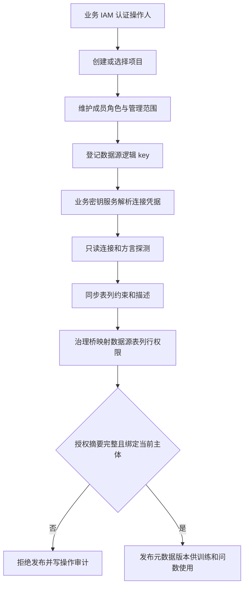

数据源实体、连接器、密钥服务和 IAM 由业务实现。Starter 只消费绑定 `projectId + operatorId + datasourceKey + purpose` 的授权摘要，不以连接成功或元数据存在推断权限。

## 训练与 MDL 语义模型闭环

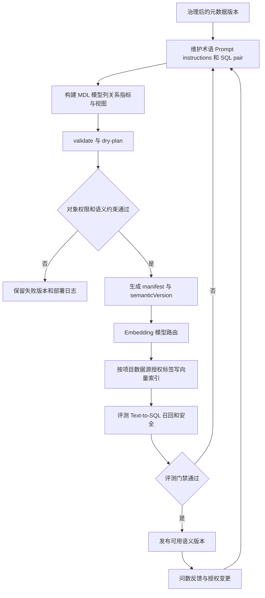

当前 Core/Starter 提供元数据、向量、版本、权限和评测接入边界；MDL 管理、训练 UI、连接器和真实评测服务属于业务模块，未在默认功能清单中宣称已实现。

## 业务流程

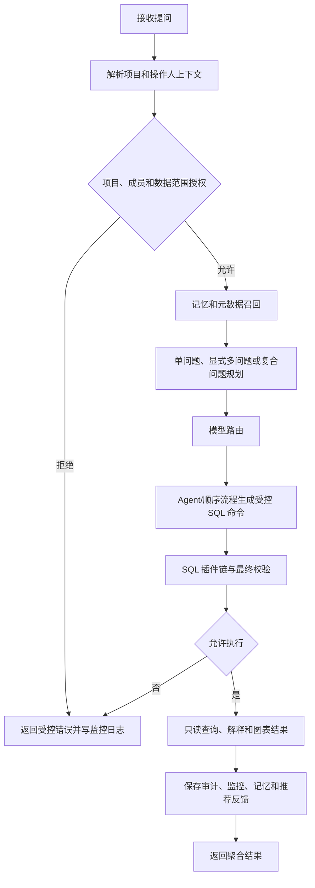

## 技术流程

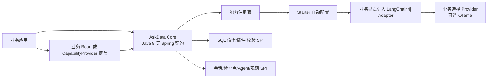

## 模型 fallback

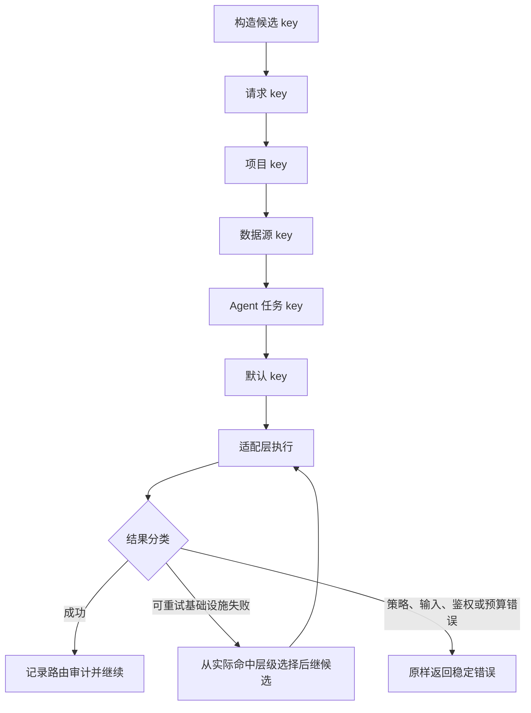

## Java 17 Remote Runtime

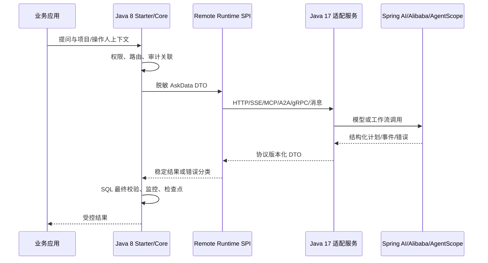

## SQL safety

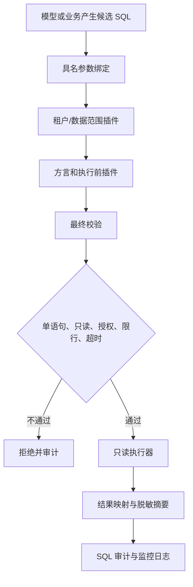

## Recovery

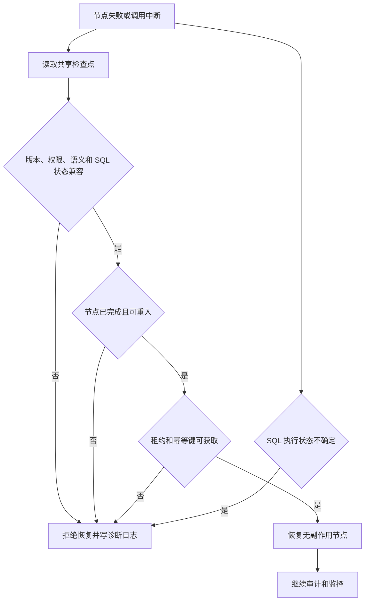

## Monitoring

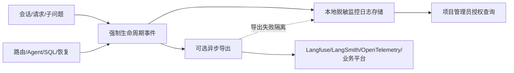

## 推荐闭环

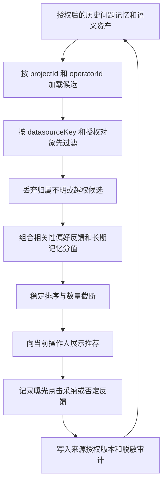

通用候选不得携带个人画像分值；授权版本变化、成员撤销或数据源权限收窄后，旧候选必须重新过滤，不能仅依赖历史排序结果。

## 前后端联调

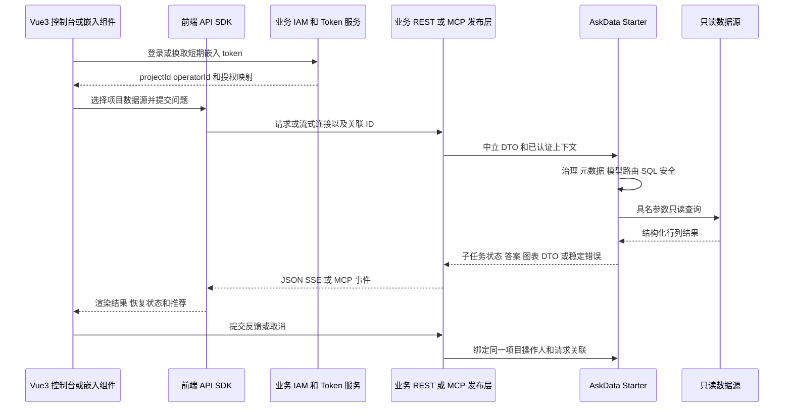

页面不得持有 appSecret、数据库凭据或 Provider API Key。Mock 服务先固定 DTO、错误和事件顺序；后端接入后使用相同契约完成项目切换、超时、取消、部分失败、恢复、越权和脱敏联调。

## 外部集成

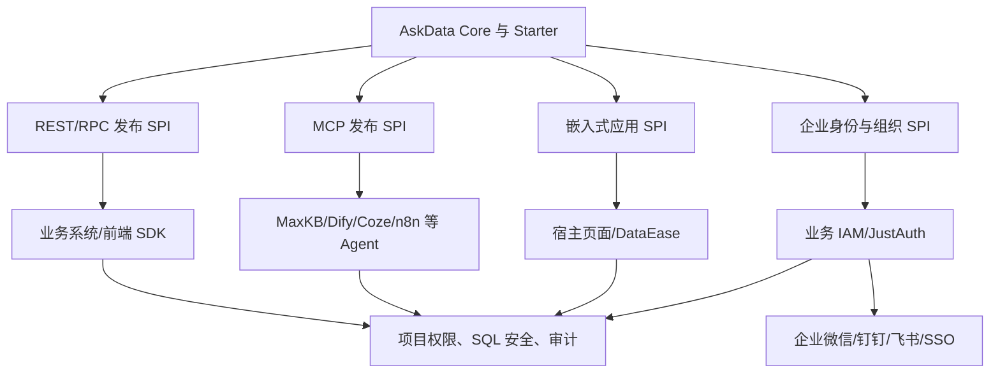
