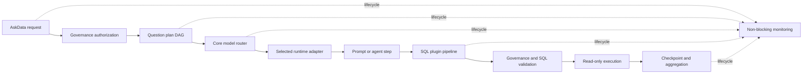

## Context

当前存在三层模型抽象：`fw-plus-ai-model` 负责模型配置和注册，`fw-plus-ai-askdata` 定义业务级模型 SPI，AI 自动配置又定义了一套同名 Chat/Embedding 接口。默认 Flow 依赖自动配置内部接口，因此 Core SPI 和能力注册表没有成为真实运行边界。Embedding Store 已具备中立 CRUD 与相似度检索模型，但 AskData 的过滤条件没有传入存储查询。

本 change 同时修复上一轮复核确认的执行缺口，但仍维持清晰边界：中立模型模块只表达模型能力，AskData Core 只表达问数业务语义，框架 Adapter 只负责 SDK 类型转换和异常分类，Starter 只负责发现、选择和接线。

## Goals / Non-Goals

**Goals:**

- 让默认 AskData Flow 只依赖公开 Core SPI，并允许业务按单项能力替换。
- 使 LangChain4j 在 Java 8 分支成为首个完整 Adapter，但保持业务显式选择。
- 使模型路由、多问题、SQL 插件、Agent 替换、监控和压缩满足正式规格。
- 为 Java 17 / Spring Boot 3 分支实现 Spring AI、Spring AI Alibaba、AgentScope Adapter 提供稳定契约。
- 保持现有 Java 8 API 的源代码兼容，必要时通过 deprecated 桥接层迁移。

**Non-Goals:**

- 不在当前分支引入 Spring AI、Spring AI Alibaba 或 AgentScope 运行时依赖。
- 不默认引入 LangChain4j Adapter、Ollama Provider 或模型凭据配置。
- 不删除仍有调用方的旧自动配置接口；本 change 只停止默认流程依赖它们并提供迁移桥。
- 不处理 AskData 之外的 MagicAPI、TinyEngine 或其他业务模块。

## Decisions

### 1. 分离模型发现、类型化执行和 AskData 业务语义

`AiModelDefinition`、`AiModelAdapter`、`AiModelRegistry` 继续负责模型定义、Adapter 选择、实例创建和按 key 查询。`fw-plus-ai-model` 新增厂商无关的类型化 Chat/Embedding 能力及不可变请求/结果对象，表达输入、批量文本、模型参数、超时、实际模型 key、结束原因和用量摘要，不包含 Spring、LangChain4j 或 AskData 项目类型。

AskData Core 的 `AskDataChatModel`、`AskDataEmbeddingModel` 保留项目和操作人上下文，作为业务替换 SPI。默认桥接实现从 `AiModelRegistry` 解析类型化模型，再将 AskData 请求转换为中立请求。这样通用模型能力可被 MagicAPI 等模块复用，AskData 的权限上下文又不会污染通用模型模块。

### 2. Embedding 模型与 Embedding Store 保持独立

Embedding 模型负责把文本转换为向量，Embedding Store 负责保存和检索向量。`AiEmbeddingQuery` 增加不可变过滤条件，Store Adapter 必须明确支持、拒绝或安全降级过滤能力，不得静默忽略权限相关过滤条件。AskData Retriever 将已授权过滤条件传入 Store；不能证明过滤已生效时由上层再次过滤或拒绝。

### 3. LangChain4j 是当前实现，不是 Starter 默认依赖

LangChain4j Adapter 实现中立 Chat/Embedding 能力，并提供到 AskData Core SPI 的桥接。业务引入 Adapter Starter 和所需 provider SDK 后，自动配置按 `framework=langchain4j` 和稳定模型 key 注册能力。没有 Adapter 时，AskData Starter 仍能启动，但只有在实际请求模型能力且未配置实现时返回明确诊断。

Spring AI、Spring AI Alibaba、AgentScope 的 Adapter 不在本分支编译。文档固定它们在 Java 17 / Spring Boot 3 分支实现，并要求复用相同请求/结果、能力描述符、错误分类、事件和 Remote Runtime 关联字段。

### 4. Core SPI 成为自动配置事实边界

自动配置收集 Core `AskDataCapabilityProvider`，构造唯一 `AskDataCapabilityRegistry`，在启动期验证版本、key 和冲突。默认 Bean 只在业务没有提供对应 Core SPI 时创建。旧元数据、会话、模型和 Embedding 接口通过单向 Adapter 接入 Core，禁止 Core 实现再反向委托旧接口形成循环。

### 5. 多问题执行使用显式 DAG

每个 `AskDataSubQuestion` 必须包含稳定 ID、问题文本、依赖 ID、失败策略和可选超时。调度器只并发执行依赖已满足的节点，并受配置的最大并发度约束。取消、超时、依赖失败和执行失败均产生不同终态；聚合结果按 ID 返回，不把未完成节点标记成功。每个子问题继续执行完整治理、模型、SQL、检查点和审计管线。

### 6. 模型路由围绕一次幂等模型节点执行

Flow 先构造包含请求、项目、数据源、Agent 任务和默认 key 的 `AskDataModelRequest`，由 Core Router 产生候选。Adapter 将 SDK 异常映射为可重试基础设施失败或不可重试拒绝。只有模型节点且尚未发生外部副作用时允许切换；每次尝试发布事件并写入检查点，最终响应记录实际模型 key 和路由原因。

### 7. SQL 插件使用阶段化不可变命令

插件输出的 SQL、具名参数、受控结构片段和审计摘要均进入下一节点；安全上下文和授权摘要不能被插件扩大。管线至少包含 `COMPOSE`、`REWRITE`、`PREPARE`、`RESULT_MAP`、`AUDIT` 阶段。插件后统一重新检查授权表列、行级谓词、单语句、只读、限行和超时。参数冲突、未知阶段和顺序冲突在启动或执行前失败。

### 8. Agent 通过步骤 key 替换默认节点

Agent 能力声明其替换的稳定步骤 key 和优先级。每个步骤只有一个替换实现；重复替换在启动期失败。Agent 输出使用类型化步骤结果更新上下文，成功替换 SQL 生成后直接进入默认 SQL 校验，不再无条件调用默认模型生成。

### 9. 观测永远不改变业务结果

Flow 对问题计划、子问题、模型尝试、Agent、SQL 插件/校验/执行、记忆、压缩、检查点、恢复、取消、完成和失败发布脱敏事件。基础监控写入和外部导出都在隔离边界内执行；外部存储失败时尝试写入本地固定容量环形日志，环形日志失败也只记录受控诊断，不向业务 Flow 抛出。

### 10. 压缩器由业务选择语义实现

默认压缩器不依赖任何 AI 框架，按结构化字段优先级生成确定性摘要并保留恢复所需字段。LangChain4j Adapter 可提供语义压缩器，业务通过 Bean 或能力 key 选择。语义压缩失败时回退默认压缩器；任何压缩器都不能删除项目、操作人、模型 key、数据源、SQL 状态、错误和已完成步骤。

## Data Flow

## Compatibility and Migration

1. 为旧构造方法和简单字符串 Chat/Embedding 调用保留兼容重载，并标记迁移路径。
2. 自动配置内部同名接口标记 deprecated，由 Core Adapter 包装；新代码不得继续新增对它们的依赖。
3. Starter POM 继续只传递 Core、中立模型/存储和自动配置，不传递具体 AI 框架。
4. 业务现有 LangChain4j Bean 通过 Adapter 自动发现；业务自定义 Core SPI 的优先级高于默认桥接。
5. Spring Boot 3 分支实现其他 Adapter 时不得修改 Core 公共签名，只能新增 Adapter 模块或 Remote Runtime 客户端。

## Error Handling

- 未配置模型、未知能力 key、重复 Adapter、契约版本不兼容：启动期或首次解析时返回包含 key/framework/provider/type 的明确错误。
- 模型基础设施故障：按 Router 候选链有限切换；不可重试拒绝立即返回。
- 子问题超时/取消/依赖失败：记录独立终态和原因，允许按计划返回部分结果。
- SQL 插件输出冲突或越权：拒绝执行，记录插件 key 和阶段，不记录敏感参数值。
- 监控或语义压缩失败：使用本地观测或确定性压缩降级，不改变业务成功状态。

## Verification

- 使用 Zulu JDK 8 编译 Core、LangChain4j Adapter、AI 自动配置和 Starter。
- 为中立 Chat/Embedding、Store 过滤、Adapter 选择和重复冲突添加契约测试。
- 为 Core SPI Bean 优先、旧接口桥接和能力注册添加 Spring 上下文测试。
- 为多问题 DAG、并发上限、依赖、超时、取消和部分结果添加确定性测试。
- 为模型路由尝试、故障分类、最终模型 key 和检查点恢复添加测试。
- 为 SQL 参数传播、阶段顺序、结果映射和插件后安全复检添加测试。
- 为 Agent 步骤替换、监控失败隔离、完整事件序列和压缩降级添加测试。
- 验证 Starter 依赖树不包含 LangChain4j Provider、Spring AI、Spring AI Alibaba 或 AgentScope。

## Risks / Trade-offs

- 公共模型接口增强会扩大编译影响面：使用兼容重载和 Adapter 迁移测试控制风险。
- 多问题并发可能放大数据库和模型压力：默认并发度保持保守，并允许按请求和全局配置收紧。
- 本地监控 fallback 可能丢失重启前日志：文档明确容量和易失性，集群要求业务选择共享存储。
- Java 17 Adapter 延后会暂时只提供契约：文档必须标记“未在当前分支实现”，不得宣称已可用。
