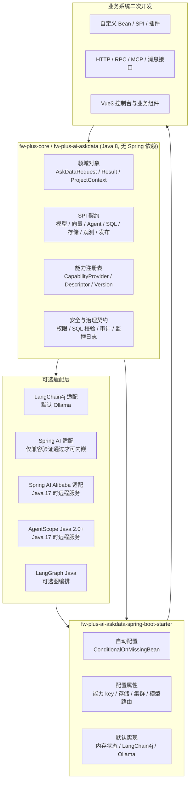
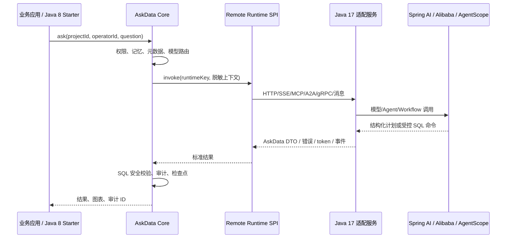
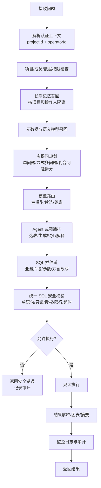

# fw-plus AskData Core Starter 重构设计

## 1. 设计结论

本 change 采用“渐进式六边形架构”：在 `fw-plus-core/fw-plus-project/fw-plus-ai` 新增无 Spring 依赖的 `fw-plus-ai-askdata` Core 契约模块；默认 Starter 继续复用现有 LangChain4j 封装和 Ollama 默认厂商；所有模型、向量、SQL、安全、Agent、状态、记忆、推荐、监控和外部发布能力均通过 AskData 自有 SPI 与能力注册表装配。

该方案保留 Java 8 / Spring Boot 2.7.18 主基线，不把 Spring AI、Spring AI Alibaba、AgentScope Java、LangGraph、Ollama 或任何存储厂商类型泄露进 Core API。若 Spring AI、Spring AI Alibaba、AgentScope Java 2.0+ 只能在 Java 17 / Spring Boot 3.x+ 运行，则通过 Java 17 独立适配服务对接，Java 8 Starter 只调用 Remote Runtime SPI，并继续掌握项目权限、SQL 安全、审计、检查点和管理员监控日志。

## 2. 目标与边界

### 2.1 本 change 目标

- 建立 AskData Core Java 8 契约和可二次开发 SPI。
- 默认支持当前 LangChain4j/Ollama 运行时，聊天默认 `qwen3:32b`，向量默认 `bge-m3`。
- 定义可替换运行时边界：LangChain4j、Spring AI、Spring AI Alibaba、AgentScope Java 2.0+、业务自定义运行时。
- 定义 Remote Runtime SPI，支持 Java 17 独立适配服务。
- 定义多 Agent、可选 LangGraph Java、自动上下文压缩、故障恢复、集群状态和多存储能力。
- 定义模型动态路由、候选链、单点故障切换和兜底模型策略。
- 定义长期记忆、多提问、按项目和操作人推荐、强制对话监控日志。
- 定义 SQL 插件管线，支持业务像 MyBatis 插件一样拼接 SQL，但最终必须进入统一安全校验。
- 定义 SQLBot 与 WrenAI 全功能追踪矩阵入口，不能用 Doris 或单个功能代表完整覆盖。
- 交付后端 Starter 的详细文档结构、流程图、数据库设计文档和测试用例文档要求。

### 2.2 非目标

- 本 change 不直接实现 Vue3 控制台，控制台由前端 change 先行。
- 本 change 不直接完成项目成员权限、训练检索、REST/MCP、企业平台对接和 DataEase 全部接口实现，但必须为这些能力定义后端扩展和审计边界。
- 本 change 不把 Java 17、Spring Boot 3.x 或 Python 运行时引入 Java 8 Starter 主依赖树。
- 本 change 不允许任何模型运行时绕过 SQL 安全、项目权限、审计、检查点和管理员监控日志。

## 3. 模块架构



## 4. 包与核心对象设计

建议 Core 模块包结构：

```text
com.xiongx9527.fw.plus.ai.askdata
├── api                # AskDataService 门面、请求、响应、错误模型
├── context            # ProjectContext、OperatorContext、DataScope
├── capability         # 能力描述符、注册表、版本协商
├── model              # ChatModel、EmbeddingModel、ModelRouter SPI
├── runtime            # 本地/远程 AI 运行时 SPI
├── agent              # Agent、子任务、图编排、节点状态
├── memory             # 长期记忆、召回、遗忘、推荐画像
├── metadata           # 数据源、表、列、语义模型、方言能力
├── retrieval          # 训练检索、向量检索、RAG 上下文
├── sql                # SQL 命令、插件、校验、执行、审计
├── storage            # 会话、检查点、Agent 状态、监控日志存储
├── observability      # 事件、监控日志、LangSmith/Langfuse 导出契约
└── integration        # HTTP/MCP/DataEase/嵌入式等发布契约抽象
```

核心对象保持 Java 8 兼容，禁止使用 Java 9+ API。公开接口必须有详细中文注释，解释业务含义、扩展方式、调用约束和禁止行为。

## 5. 运行时适配设计

### 5.1 默认 LangChain4j / Ollama

默认路径复用当前 fw-plus LangChain4j 封装。Starter 自动配置负责把 LangChain4j 的聊天模型、Embedding 模型、工具调用和向量检索包装成 AskData 自有 SPI。

默认配置只存在于 Starter：

- 默认聊天能力 key：`ollama.chat.default`
- 默认模型标签：`qwen3:32b`
- 默认向量能力 key：`ollama.embedding.default`
- 默认向量模型标签：`bge-m3`

Core 只识别逻辑能力 key，不依赖 Ollama 类型。

### 5.2 Spring AI / Spring AI Alibaba / AgentScope Java 2.0+

适配策略分两类：

1. 内嵌适配：只有通过 Java 8 / Spring Boot 2.7.18 的 BOM 解析、最小 Maven 编译和启动测试后，才允许作为可选适配模块。
2. 远程适配：若官方基线要求 Java 17+、Spring Boot 3.x+ 或其他不兼容依赖，则不进入 Starter 传递依赖，改由 Java 17 独立适配服务提供能力。

当前设计基线要求文档记录：

- 官方文档或 BOM 要求。
- 验证版本。
- 失败现象，例如 class file version、Jakarta/Javax 冲突、Spring Boot 自动配置不兼容。
- 是否允许内嵌。
- 若不允许内嵌，Java 17 适配服务如何部署、鉴权、注册、回滚和联调。

### 5.3 Java 17 独立适配服务



Java 17 服务必须遵守：

- 不直接访问业务数据库。
- 不持有业务裸连接。
- 不绕过 Java 8 Starter 的项目权限和 SQL 安全管线。
- 输入输出使用 AskData 自有 DTO 或协议 schema。
- 每次调用携带 `projectId`、`operatorId`、`conversationId`、`requestId`、能力 key 和审计关联 ID。
- 支持超时、重试、熔断、流式事件、错误映射和回滚。

## 6. 能力注册与业务覆盖

`AskDataCapabilityProvider` 返回能力描述符：

- 能力类型：模型、向量、SQL 插件、状态存储、Agent、观测、发布接口等。
- 稳定 key。
- 契约版本范围。
- 优先级。
- 配置命名空间。
- 依赖和兼容性说明。

`AskDataCapabilityRegistry` 在启动期完成：

- 能力发现。
- 版本协商。
- 冲突检测。
- 集群模式校验。
- 未知 key 诊断。

业务系统可以通过三种方式覆盖默认行为：

1. 提供同类型 Spring Bean。
2. 注册新的 CapabilityProvider。
3. 完整实现 `AskDataService` 接管流程。

自动配置只能在缺少业务实现时生效。

## 7. 问数主流程



## 8. SQL 插件管线

SQL 不再被限定为“模型生成后直接 JDBC 执行”。Core 定义不可变 `AskDataSqlCommand`、受控 SQL 片段和具名参数。

插件阶段：

1. 意图到模板/片段组装。
2. 参数绑定。
3. 安全校验前改写。
4. 执行前准备。
5. 执行后结果映射。
6. 审计补充。

禁止行为：

- 插件直接拿裸连接。
- 插件拼接未绑定的动态值。
- 插件绕过最终安全校验。
- 插件把写 SQL、多语句或未授权对象标记为可信。

所有插件产出的最终 SQL 必须重新进入单语句、只读、授权对象、方言、物理限行和超时校验。

## 9. 状态、恢复与集群

状态分为：

- 会话状态。
- 检查点。
- Agent 图/节点/子任务状态。
- 长期记忆。
- 推荐画像。
- SQL 审计。
- 监控日志。
- 幂等键和租约。

默认单机实现使用内存；集群模式必须使用共享存储。共享存储可组合：

| 状态类别 | 单机默认 | 集群建议 | 说明 |
| --- | --- | --- | --- |
| 会话/消息 | 内存 | JDBC | 需要可恢复 |
| 检查点 | 内存 | JDBC/Redis | 需要版本和恢复 token |
| Agent 状态 | 内存 | Redis/JDBC | 需要租约和幂等 |
| 监控日志 | 内存环形 | JDBC/消息系统 | 管理员查询 |
| 长期记忆 | 内存 | JDBC/向量库 | 按项目和操作人隔离 |
| 向量检索 | 内存向量 | 向量库 | 集群不得静默用本地内存 |

恢复规则：

- 只从已完成且可重入节点恢复。
- SQL 执行中状态不确定时不自动重放。
- 租约获取失败时返回可诊断错误。
- 权限、语义版本或 SQL 校验状态不兼容时拒绝恢复。

## 10. 模型路由与兜底

模型路由优先级：

1. 请求显式模型 key。
2. 项目配置。
3. 数据源配置。
4. Agent 任务策略。
5. Starter 默认模型。

可切换故障：

- 连接失败。
- 超时。
- 限流。
- 熔断打开。
- 供应商不可用。

不可切换错误：

- 内容策略拒绝。
- 输入不兼容。
- 预算不足。
- 结构化输出不可接受且策略禁止重试。

模型兜底只覆盖幂等模型推理节点，不覆盖已开始的 SQL、工具或外部副作用节点。

## 11. 长期记忆与按人推荐

所有记忆和推荐均以项目为第一分区，以认证操作人为第二分区：

```text
projectId + operatorId + datasourceKey + semanticVersion
```

推荐流程：

1. 在当前项目、数据源和权限范围内构造候选问题、指标或语义对象。
2. 只读取当前操作人在当前项目下的偏好、反馈、长期记忆和已确认历史。
3. 输出推荐结果和过滤原因。

不同操作人之间不得共享个人画像或排序特征。

## 12. 多提问

`AskDataRequest` 支持：

- 单问题。
- 显式问题列表。
- 自然语言复合问题。

`AskDataQuestionPlanner` 生成子问题计划：

- 子问题 ID。
- 依赖关系。
- 执行预算。
- 并发限制。
- 项目/数据源边界。

每个子问题独立完成权限、记忆、模型路由、SQL 插件、安全校验、执行和审计。部分失败时返回结构化聚合结果，不能伪造整体成功。

## 13. 监控日志与外部观测

每次对话必须记录监控日志：

- 会话开始。
- 请求接收。
- 子问题规划。
- 模型路由与兜底。
- Agent 节点开始/结束。
- SQL 插件、校验和执行。
- 检查点和恢复。
- 完成或失败。

日志绑定 `projectId + operatorId + conversationId`。项目管理员可查本项目日志；跨项目平台管理员必须由业务显式授权。

LangSmith、Langfuse 和 OpenTelemetry 导出为可选异步适配。导出失败不能影响问数结果，本地脱敏监控日志仍须保留。

## 14. SQLBot 与 WrenAI 功能矩阵

`openspec/changes/rework-ai-askdata-core-starter/feature-list.md` 是设计期事实源。正式说明文档必须生成可追踪矩阵，字段至少包括：

- product
- category
- feature
- source
- priority
- duplicatePolicy
- change
- module
- apiOrConfig
- storage
- docs
- tests
- status
- limitation

SQLBot 优先，WrenAI 必须覆盖。重复项采用 SQLBot 产品语义，吸收 WrenAI 底层增强。

## 15. 文档交付

实现和业务接入验证必须同步维护以下中文文档：

- Starter 说明首页和已实现功能清单。
- 架构与模块设计文档。
- 完整配置属性参考。
- AI 运行时替换文档。
- Java 17 独立适配服务文档。
- 存储能力矩阵。
- SQL 插件 SDK。
- SQL 安全文档。
- 多 Agent、多提问、长期记忆和推荐文档。
- 管理员监控日志和 LangSmith/Langfuse 文档。
- 单机与集群部署文档。
- 数据库设计文档。
- 业务流程图和技术流程图文档。
- 测试用例文档。
- SQLBot/WrenAI 全功能追踪矩阵。

## 16. 数据库设计文档范围

数据库设计文档至少覆盖逻辑表：

- 项目、成员、角色、授权。
- 数据源、数据集、表、列元数据。
- 语义模型/MDL、指标、关系、视图。
- 术语、SQL 样例、Prompt、训练文档。
- 向量索引引用。
- 会话、消息、子问题。
- 长期记忆、推荐画像和反馈。
- SQL 审计、监控日志、操作日志。
- Agent 图状态、节点状态、租约、幂等键。
- 模型配置、路由策略、API Key。
- MCP/API 发布、嵌入 token、DataEase 对接。
- 企业平台对接、登录认证、参数配置。
- 能力插件注册。

每张表必须说明字段、主键、唯一键、索引、项目/操作人隔离字段、脱敏字段、保留策略、单机/集群建议和迁移版本。

## 17. 测试策略

测试分层：

1. Core 单元测试：领域对象、能力注册、版本协商、错误模型。
2. SPI 契约测试：模型、向量、SQL 插件、状态存储、监控日志。
3. 自动配置测试：默认 LangChain4j/Ollama、条件装配、业务覆盖。
4. SQL 安全测试：只读、多语句、未授权对象、限行、超时、插件输出重校验。
5. 存储一致性测试：内存、JDBC、Redis、租约、幂等、恢复。
6. 模型路由测试：主模型、候选、兜底、不可切换错误。
7. 多 Agent/恢复测试：节点状态、子任务失败、执行中 SQL 不重放。
8. 长期记忆/推荐测试：项目和操作人隔离、权限撤销、过期过滤。
9. 监控审计测试：生命周期事件、管理员访问策略、导出失败隔离。
10. Java 17 远程运行时契约测试：鉴权、流式、错误映射、回滚。
11. 文档示例测试：Java 配置片段编译、配置样例可解析。
12. 前后端联调测试：Vue3 API SDK、Mock 到真实后端切换。

## 18. 实施顺序

本 change 进入 build 后按以下顺序实施：

1. Core 契约与能力注册表。
2. 状态存储和监控日志基础能力。
3. LangChain4j/Ollama 默认适配。
4. 模型路由、候选和兜底。
5. SQL 命令、插件和安全管线。
6. 多提问、长期记忆、推荐。
7. Agent 状态和可选图编排 SPI。
8. Remote Runtime SPI 和 Java 17 适配服务契约样例。
9. Starter 自动配置与兼容迁移。
10. 文档、流程图、数据库设计和测试用例。
11. 定向 Maven 测试和文档示例验证。

## 19. 主要风险与缓解

| 风险 | 缓解 |
| --- | --- |
| Java 17 运行时不兼容 Java 8 Starter | 不传递依赖，使用 Remote Runtime SPI |
| SQL 插件绕过安全 | 不给裸连接，最终 SQL 强制重校验 |
| 模型兜底掩盖业务错误 | 仅基础设施故障可切换 |
| 集群误用内存状态 | 集群启动期失败 |
| SQL 执行中断后重放 | 执行中状态返回不确定错误 |
| 推荐跨人泄露 | `projectId + operatorId` 强制隔离 |
| 文档把规划误报为实现 | 已实现清单只列验证能力，后续能力单列 |

## 20. 验收条件

- OpenSpec 严格校验通过。
- Core 契约不暴露 Spring、LangChain4j、Ollama、AgentScope、LangGraph 或 Java 17 类型。
- 默认 Starter 可在 Java 8 / Spring Boot 2.7.18 编译和启动。
- Java 17 不兼容运行时有明确文档和 Remote Runtime 对接方案。
- SQLBot/WrenAI 功能清单进入正式文档追踪矩阵。
- 每个公开 SPI 和关键默认实现有详细中文注释。
- 关键流程图、数据库设计和测试用例文档落盘。
