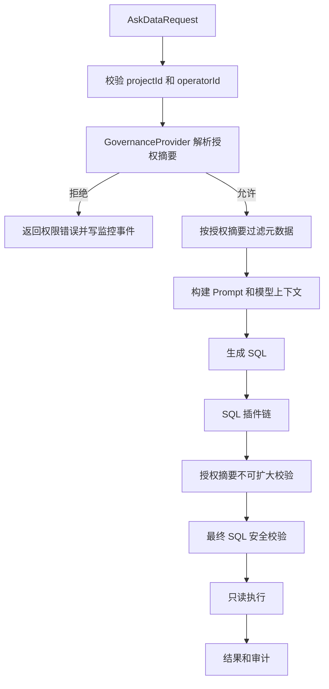

# AskData 治理权限桥接深度设计

## 背景

`rework-ai-askdata-core-starter` 已经完成 AskData Core/Starter 的 SPI、SQL 安全管线、监控日志、长期记忆、推荐和默认 LangChain4j 适配。剩余风险集中在生产治理层：默认流程目前能携带 `projectId + operatorId`，但真实项目成员、数据源、表、列、行级权限和管理员日志查询范围还没有成为统一、可测试、默认拒绝的运行时事实源。

本设计采用方案 A：新增强类型治理授权摘要，并贯穿 Core、Starter、元数据、Prompt、SQL 插件链、最终 SQL 校验、只读执行和监控日志查询。该方案为 API/MCP、训练检索、嵌入式应用和外部系统联调提供统一安全底座，但本 change 不实现这些外部入口本身。

## 目标与非目标

目标：

- 在 Java 8 Core API 中定义治理授权桥接 SPI 和最小领域对象。
- Starter 默认拒绝受保护数据访问，业务可通过 Bean/SPI 覆盖。
- 默认问数流程在模型调用前完成授权摘要解析，Prompt 只看到授权元数据。
- SQL 插件可以收窄 SQL 和授权对象，但不能扩大、清空或替换授权摘要。
- 最终 SQL 校验基于同一授权摘要重新检查表、列、系统 schema、行级条件、只读、限行和超时。
- 管理员监控日志查询受治理授权控制，并记录脱敏审计事件。

非目标：

- 不接入企业微信、钉钉、飞书、DataEase、Dify、Coze、n8n、MCP Server 或 Vue3 控制台真实联调。
- 不引入业务 IAM、JustAuth、Spring Security、Sa-Token、数据库迁移工具或 Java 17 运行时到 Core 公共 API。
- 不把训练资产、MDL 语义层、仪表板、API/MCP 发布能力并入本 change。

## 核心模型

新增 Core 包建议放在 `com.xiongx9527.fw.plus.ai.askdata.security` 或其子包下，保持无 Spring 依赖。

核心类型：

- `AskDataGovernanceProvider`：主入口，按 `AskDataProjectContext`、数据源 key 和能力请求解析授权摘要。
- `AskDataAuthorizationRequest`：包含项目上下文、数据源 key、请求用途、会话/请求标识和可选资源提示。
- `AskDataAuthorizationSummary`：不可变授权摘要，包含允许/拒绝状态、拒绝码、授权版本、来源、项目、操作人、数据源、授权对象、行级谓词和管理员查询范围。
- `AskDataAuthorizedObject`：描述数据源、schema、表、列和对象类型，避免 SQL 管线只靠字符串集合判断。
- `AskDataRowPredicate`：表达行级条件，携带受控 SQL 片段、具名参数和来源说明。
- `AskDataMonitoringLogAccessScope`：表达项目管理员和平台管理员可查询的项目范围、过滤条件和审计来源。

旧 `AskDataPermissionEvaluator` 保留。Starter 可以提供适配器将它用于粗粒度 capability 判定，但不得把其 `true` 结果解释为完整表/列/行级授权。

## 执行流程

元数据过滤是减少模型暴露面的第一道门，最终 SQL 校验是强制边界。两者使用同一授权摘要，不允许中途重新解释权限。

## Starter 自动配置

Starter 自动配置新增默认 Bean：

- `AskDataGovernanceProvider` 默认拒绝实现。
- `AskDataAuthorizationFailureHandler` 或等价内部组件，用于把拒绝摘要转换为稳定错误码和监控事件。
- 旧 `AskDataPermissionEvaluator` 兼容适配器，仅用于没有强类型治理 Bean 时的粗粒度能力判定。

所有 Bean 使用 `@ConditionalOnMissingBean`。业务实现优先级高于默认拒绝实现。生产不提供 `allowAll` 属性；开发样例通过显式测试 Bean 展示如何放行指定项目、数据源和列。

## SQL 管线约束

SQL 插件输入新增授权摘要快照。插件返回结果后执行以下检查：

- `projectId`、`operatorId`、数据源 key、授权版本不得改变。
- 授权对象集合只能保持或收窄，不得新增未在摘要中的表/列。
- 行级谓词不得被移除；新增谓词必须使用受控 SQL 片段和具名参数。
- 最终 SQL 校验必须重新解析引用对象，并与授权摘要比对。

恶意插件清空授权对象、删除行级谓词或注入未授权列时，应在最终校验前或最终校验阶段失败，并写入脱敏监控事件。

## 监控日志访问

管理员日志查询和普通对话历史分开。治理桥接为监控查询返回 `AskDataMonitoringLogAccessScope`：

- 项目管理员只能查询授权项目。
- 平台管理员只能查询业务明确允许的项目范围。
- 普通操作人默认拒绝管理员日志查询。

查询事件记录主体、项目范围、过滤摘要、结果数量和授权来源，不记录日志正文、SQL 参数值或外部密钥。

## 迁移与兼容

- 现有 Core API 和 `AskDataPermissionEvaluator` 不删除。
- 未接入治理层的生产请求会从“隐式允许/空元数据”转为明确拒绝，这是有意的安全收紧。
- 样例和文档提供开发测试桩，避免本地演示无法启动。
- 文档矩阵只提升治理权限相关状态，外部系统仍保持后续联调范围。

## 测试策略

Core 测试：

- 构造授权摘要、拒绝摘要、授权对象和行级谓词。
- 验证缺少 `projectId/operatorId`、跨项目、跨操作人和授权对象扩大失败。
- 验证 Core 类型不暴露 Spring、JustAuth、Sa-Token 或其他框架类型。

Starter 测试：

- 默认无治理实现时拒绝真实数据访问。
- 业务 `AskDataGovernanceProvider` Bean 优先。
- 旧 `AskDataPermissionEvaluator` 只能提供粗粒度判定。
- `CoreAskDataServiceAdapter` 在模型调用前处理权限拒绝。

SQL 测试：

- 元数据提供器只返回授权表列。
- 行级谓词使用具名参数绑定。
- SQL 插件清空授权对象、移除行级谓词或引用未授权列时失败。
- 最终 SQL 校验仍捕获插件后的未授权对象。

观测测试：

- 未授权数据源/表/列写入权限拒绝事件。
- 项目管理员查询本项目日志通过。
- 平台管理员只返回授权范围。
- 普通操作人查询管理员日志被拒绝。

## 风险与缓解

- Core 类型增加：只建模 AskData 所需授权事实，不引入宿主用户表或框架类型。
- 默认拒绝影响旧样例：用显式开发测试 Bean 和清晰错误码解决。
- 权限重复校验增加复杂度：授权摘要作为单一事实源，元数据过滤和最终 SQL 校验分别承担暴露面控制和强制执行。
- 外部系统范围误解：proposal、design、docs 和矩阵持续标明本 change 不做真实外部租户联调。

## 实施顺序

1. Core 新增治理 SPI 和领域对象。
2. Core 测试先覆盖默认拒绝、授权摘要、行级谓词和兼容边界。
3. Starter 自动配置接入默认拒绝和业务覆盖。
4. 默认 Flow、元数据、SQL 管线和监控日志查询消费授权摘要。
5. 补齐 SQL/观测/自动配置测试。
6. 更新文档和 SQLBot/WrenAI 矩阵。
7. 执行 OpenSpec、Core、AI 自动配置和文档验证。
